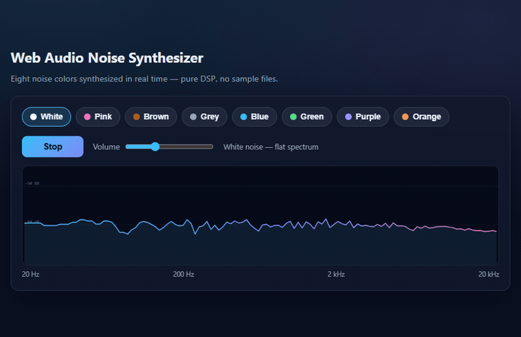

# Web Audio Noise Synthesizer

Eight noise colors synthesized in real time with the Web Audio API

## Run it

Open `index.html` in any modern browser — no build, no install, no dependencies.

## How it works

A single function fills a stereo buffer with the chosen noise color — every branch is a different filter applied to the same white-noise source: a six-pole IIR for pink, a leaky integrator for brown, a first-order high-pass for blue. An AnalyserNode then measures the result, and each point on the curve is the mean level of a 1/6-octave band.

The full implementation, controls and edge cases live on the live site — the snippet above is the core idea only.

### Measured spectrum slopes

The table below is what the analyser actually measures for the eight recipes in this
engine — the mean level of each 1/6-octave band, from 100 Hz to 10 kHz:

| Color | Slope (dB/oct) | Character |
|-------|----------------|-----------|
| White | ~ 0 | flat spectrum |
| Pink | -3.2 | equal energy per octave |
| Brown | -5.6 | steep low-frequency roll-off |
| Grey | -2.2 | softened pink |
| Blue | -0.6 | near flat, slight downward tilt |
| Green | -1.8 | low weighted |
| Purple | -4.8 | strongly low weighted |
| Orange | -3.5 | heavy low end |

Each recipe is a hand-tuned blend that the live site runs as well, so a couple of
them differ from the textbook definition of the same name. The curve in the preview
is measured live from the running synthesiser, so the picture and the table always
agree.

## Live version

▶ **Live site** https://silencefun.com/en/

> The synth engine behind the ambient scenes on silencefun.com.

## SilenceFun in your language

The full site, localised — pick your language and it opens the matching home page:

- [English](https://silencefun.com/en/) — White noise, rain sounds and ambient scenes for sleep and focus
- [中文](https://silencefun.com/zh/) — 白噪音、雨声与助眠环境音
- [繁體中文](https://silencefun.com/zh-TW/) — 白噪音、雨聲與助眠環境音
- [日本語](https://silencefun.com/ja/) — ホワイトノイズ、雨音と睡眠用アンビエンス
- [한국어](https://silencefun.com/ko/) — 화이트 노이즈, 빗소리와 수면용 앰비언스
- [Tiếng Việt](https://silencefun.com/vi/) — Tiếng trắng, tiếng mưa và âm thanh thư giãn
- [Español](https://silencefun.com/es/) — Ruido blanco, sonido de lluvia y ambientes para dormir
- [Français](https://silencefun.com/fr/) — Bruit blanc, bruit de pluie et ambiances pour dormir
- [Deutsch](https://silencefun.com/de/) — Weißes Rauschen, Regen und Klangambienten zum Schlafen
- [Português](https://silencefun.com/pt/) — Ruído branco, som de chuva e ambientes para dormir
- [Norsk](https://silencefun.com/no/) — Hvit støy, regnlyder og rolige lydmiljøer
- [Suomi](https://silencefun.com/fi/) — Valkoinen kohina, sateen äänet ja rauhallinen äänimaailma
- [Íslenska](https://silencefun.com/is/) — HVítið truf, regnhlóð og hljóð til svefn
- [Svenska](https://silencefun.com/sv/) — Vitt brus, regnljud och lugna ljudmiljöer
- [Dansk](https://silencefun.com/da/) — Hvid støj, regnlyd og rolige lydmiljøer
- [Polski](https://silencefun.com/pl/) — Biały szum, odgłos deszczu i spokojne dźwięki
- [Русский](https://silencefun.com/ru/) — Белый шум, дождь и атмосферные звуки для сна
- [Српски](https://silencefun.com/sr/) — Бели шум, звук кише и атмосферни звуци за спавање
- [ไทย](https://silencefun.com/th/) — เสียงขาว เสียงฝน และบรรยากาศเพื่อการนอนหลับ
- [ລາວ](https://silencefun.com/lo/) — ສຽງຂຽວ ສຽງຝົນ ແລະບ່ອນບ່ຽນໃຫ້ນອນຫຼັບ
- [Bahasa Melayu](https://silencefun.com/ms/) — Bunyi putih, bunyi hujan dan persekitaran untuk tidur
- [Bahasa Indonesia](https://silencefun.com/id/) — Derau putih, suara hujan, dan ambience untuk tidur
- [हिन्दी](https://silencefun.com/hi/) — सफ़ेद शोर, बारिश की आवाज़ और नींद के लिए वातावरण
- [Türkçe](https://silencefun.com/tr/) — Beyaz gürültü, yağmur sesi ve uyku için ortam sesleri

---
MIT licensed.
